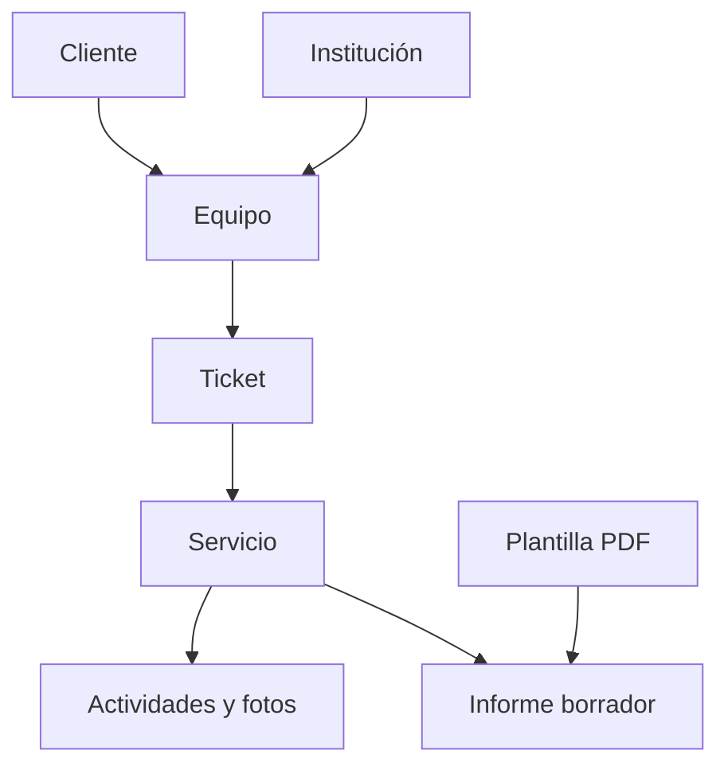

# Flujo operativo

La interfaz activa es `UI/OperationsPage.php`, Livewire con el layout normal `components.layouts.app`, en rutas `/operations/*`. `Configuration/EditorFields.php` define la ficha nativa. Los recursos Filament anteriores permanecen sin registrar como referencia de compatibilidad; no habilitan rutas ni panel. `/admin` mantiene su función administrativa.

`WorkflowDemoSeeder` crea casos ficticios relacionados por claves foráneas sin borrar ni modificar registros previos. Se ejecuta explícitamente durante la actualización; `DatabaseSeeder` normal no carga demostraciones.

# Workflow — entrada al flujo operativo

Este módulo comparte la infraestructura de seis módulos; sus modelos, campos y reglas permanecen separados en Clients, Equipment, Tickets, Services, Activities y TechnicalReports.

## Archivos principales

- `Configuration/Modules.php`: registro cerrado de módulos y modelos.
- `Configuration/Permissions.php`: autorización de lectura/gestión.
- `Queries/VisibleRecords.php`: alcance de trabajo por técnico; view_all para administración/CEO.
- `Actions/SaveRecord.php`: valida, autoriza, bloquea la fila y comprueba lock_version. Genera código/creador en servidor. Guarda en transacción y captura el informe cuando corresponde.
- `Actions/ValidateRelations.php`: verifica padres visibles y protege relaciones con historial.
- `UI/WorkflowResource.php`: esquema y tabla compartidos. Consulta sin snapshots pesados para listados de informes.
- `UI/RecordActions.php`: enlaces entre módulos, evidencias privadas y PDF por cola.
- `UI/Pages/`: páginas base de crear, editar y consultar. Convierten errores de dominio a campos del formulario; edición actualiza lock_version en la misma pantalla.
- `UI/Controllers/`: acceso privado a fotografías/PDF mediante el registro autorizado.
- `WorkspacePanelProvider.php`: panel Filament /operations/clients, idioma español y sesión existente. La capacidad de entrar al panel administrativo no es necesaria para el trabajo operativo.

## Datos y relaciones

## Reglas importantes

Las acciones nunca confían en campos de actor, código, snapshot o técnico de servicio enviados por el navegador. Solo guardan los datos validados; el servicio recibe el técnico de su ticket. Las consultas y descargas se restringen por VisibleRecords. Mantén ambas capas al añadir funcionalidades.

Cada registro lleva code único, created_by, timestamps y lock_version. No existe borrado operativo desde estas pantallas. La FK protege datos relacionados y las acciones impiden reescribir relaciones que ya tienen historial. Para implementar transferencias de equipos crea un proceso/historial específico, no retires estas protecciones sin reemplazarlas.

## Informes

`TechnicalReports/Actions/CaptureReport.php` crea la copia de datos/diseño/logos/evidencias dentro de la transacción. `TechnicalReports/Queries/ReportData.php` lee registros reales; componentes/repuestos vacíos hasta desarrollar sus módulos. ReportData tiene límites de actividades e imágenes antes de guardar. La copia y las generaciones se cifran con APP_KEY: conserva la clave existente.

`QueueTechnicalPdf.php` encola exclusivamente en database/reports el job GenerateReportPdf existente. Cada generación referencia technical_report_id y report_revision. Una copia antigua no se confunde con la revisión actual; la ruta privada comprueba la relación entre informe y generación. El PDF conserva la caducidad/limpieza existente. No se cambia el contrato de la vista previa de plantillas.

## Extender

Cambia campos en cada `Configuration/Fields.php` y agrega las mismas reglas en `Configuration/Rules.php`. Para un campo nuevo de base de datos crea otra migración; no edites una migración ya aplicada. Añade columnas en Workflow/Configuration/TableColumns.php. Para exponer un dato al PDF actualiza ReportData y la lista permitida ReportTemplates/Configuration/Variables.php.

La migración 2026_10_16_000001 es aditiva. WorkflowSeeder añade permisos mínimos sin quitar permisos personalizados. Las instalaciones nuevas llaman DatabaseSeeder; la actualización invoca WorkflowSeeder expresamente. No se ejecuta migración Ninox ni se crea contenido de demostración automáticamente.

## Pruebas

WorkflowRecordsTest, WorkflowAccessTest, WorkflowReportsTest y WorkflowUiTest. Cubren cadena, serie repetida, concurrencia, protección de historial, alcance por técnico/CEO, rechazo de padres ajenos, copia cifrada y estable, versiones publicadas, imágenes privadas, cola y descarga real, lectura de seis pantallas y edición repetida desde Filament.

Pendientes funcionales en docs/PENDIENTES_ENTIDADES.md. Uso en docs/FLUJO_OPERATIVO.md.
