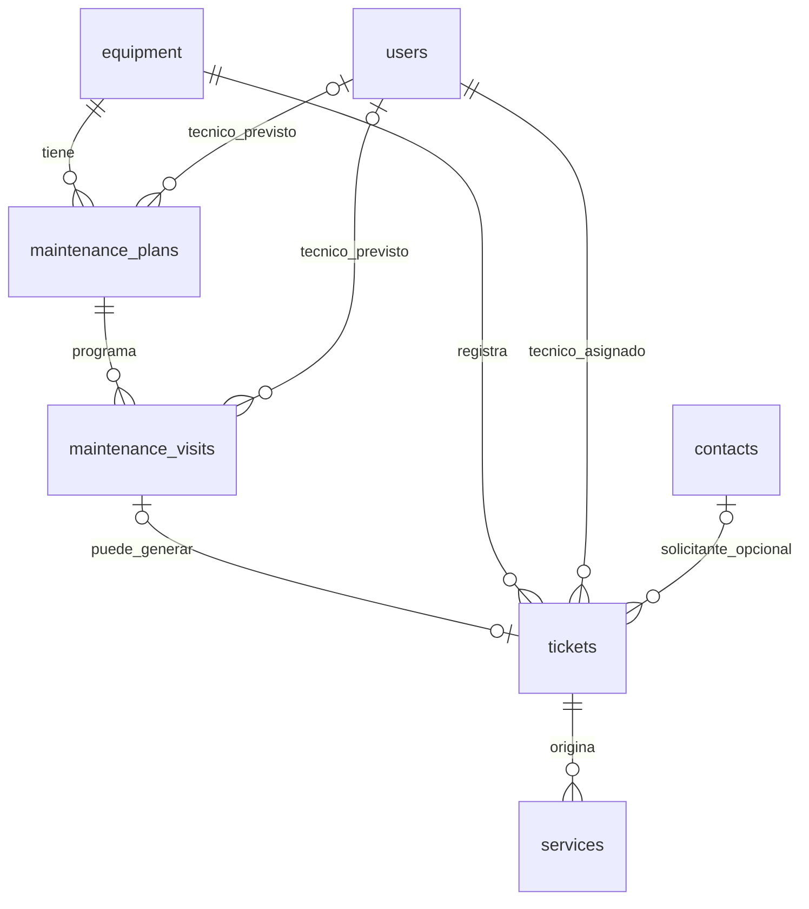

# Planificación — Relaciones implementadas

Los nombres corresponden a las tablas reales. Las flechas no muestran campos.

Un ticket puede existir sin visita y sin contacto solicitante. Cada visita genera como máximo un ticket. La referencia de contrato del plan es texto; la entidad de Contratos queda pendiente.
