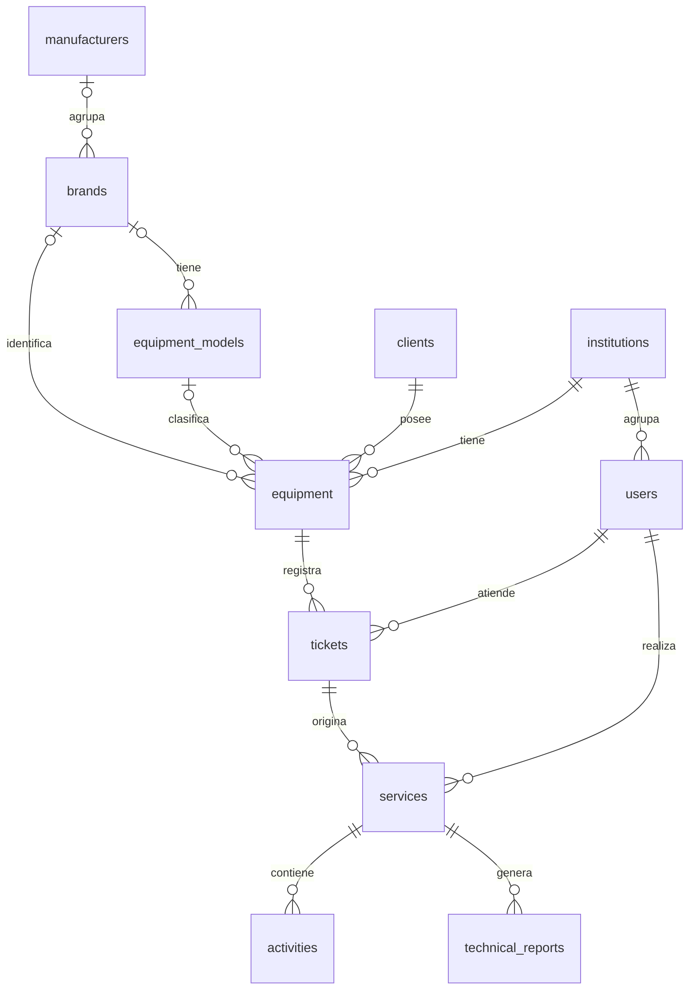
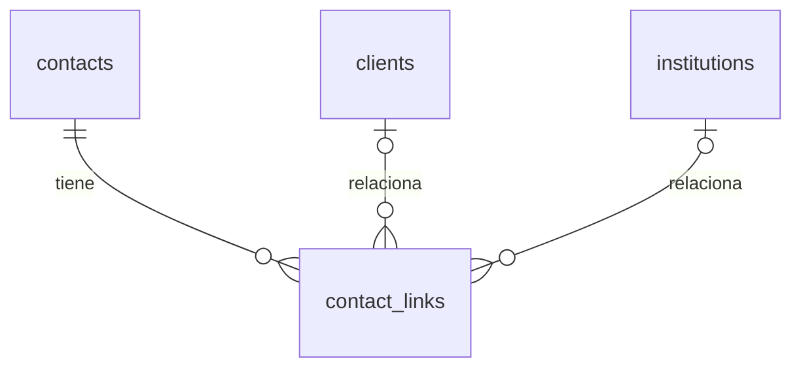
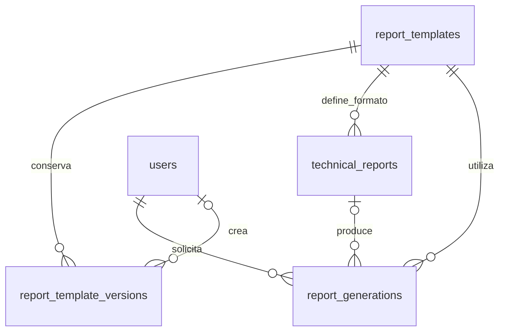
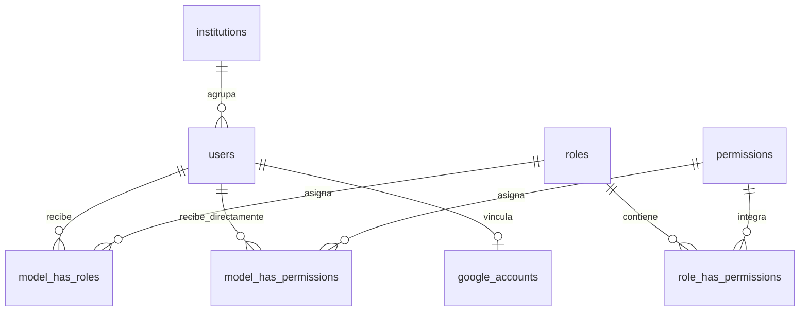

# Maintenance APP — Relaciones entre entidades

Los modelos PHP y las tablas de la base de datos están en inglés. Por ejemplo, el modelo `User` corresponde a `users` y `Institution` a `institutions`. En estos diagramas cada entidad usa el **nombre exacto de su tabla**, respetando minúsculas, plural y guiones bajos. Los títulos y las etiquetas de las relaciones se mantienen en español.

Relaciones funcionales verificadas en `maintenance-app(5).zip` (v11.50.0), que se conservan en v11.50.3. No se muestran campos ni detalles de interfaz.

## Operación y equipos

## Contactos

Una persona puede vincularse con varios clientes e instituciones. Cada vínculo corresponde a un cliente **o** a una institución. Los contactos están separados de las cuentas de usuario que acceden al sistema.

## Plantillas e informes

## Usuarios y acceso

Las tablas `model_has_roles` y `model_has_permissions` utilizan relaciones polimórficas. En este diagrama se muestra su uso para el modelo `User`. `role_has_permissions` es la tabla intermedia entre roles y permisos.

## Cómo leer las relaciones

| Notación | Significado |
| --- | --- |
| `\|\|` | Uno obligatorio |
| `\|o` u `o\|` | Cero o uno |
| `o{` o `}o` | Cero o muchos |

Por ejemplo, `equipment ||--o{ tickets` indica que un equipo puede tener cero o muchos tickets y que cada ticket pertenece a un equipo obligatorio.

Los bloques Mermaid pueden visualizarse en un editor Markdown compatible con Mermaid.
